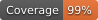

# Repository Coverage

| Name      |    Stmts |     Miss |   Cover |   Missing |
|---------- | -------: | -------: | ------: | --------: |
| run.py    |      383 |        2 |     99% |  738, 740 |
| **TOTAL** |  **383** |    **2** | **99%** |           |

## Setup coverage badge

Below are examples of the badges you can use in your main branch `README` file.

### Direct image

This is the one to use if your repository is private or if you don't want to customize anything.

## What is that?

This branch is part of the
[python-coverage-comment-action](https://github.com/marketplace/actions/python-coverage-comment)
GitHub Action. All the files in this branch are automatically generated and may be
overwritten at any moment.